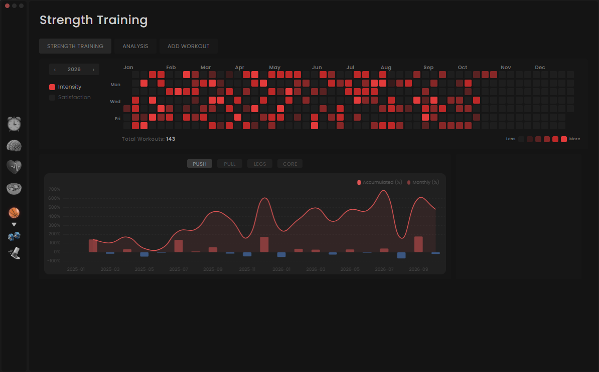
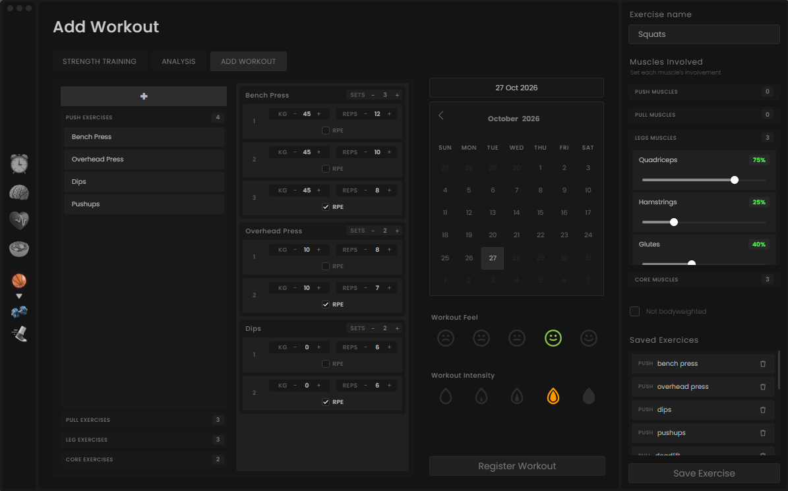

# Health Tracker

A desktop app to log and analyze strength training: workout logging, custom exercises with muscle involvement, an activity heatmap, and progress metrics based on estimated one-rep max.

> Active development: only the Strength Training module is implemented so far.

## Screenshots
<br>*Overview with the yearly activity heatmap.*
<br>*Workout logging.*

## Features
- Logs workouts with exercises, sets, weight, reps, and failure flag, plus a satisfaction and intensity rating per workout.
- Creates custom exercises by assigning muscle involvement; exercises are validated and classified automatically as push, pull, legs, or core.
- Shows a yearly activity heatmap colored by intensity or satisfaction.
- Computes progress per category from the estimated one-rep max (Epley formula): average daily, monthly, and accumulated monthly progress, displayed in charts.
- Keeps a snapshot of each exercise's name, category, and muscle involvement in the workout history, so past metrics stay accurate when exercises change.
- Stores all data locally in SQLite.

## Architecture

The Electron frontend talks to a Python backend over a WebSocket (`ws://localhost:8765`) using JSON messages (`{type, payload}`). A message router dispatches each message to a handler, which validates the input and persists data through repositories built on SQLAlchemy 2.0 and SQLite (foreign keys enforced, WAL mode). Progress metrics are computed with pandas. Electron launches the backend automatically.

## Tech stack
- **Backend:** Python, websockets, SQLAlchemy, SQLite, pandas.
- **Frontend:** Electron, JavaScript, HTML, CSS, Chart.js, flatpickr.

## Project structure
```text
backend/
  infrastructure/database/        # SQLAlchemy engine, models, and repositories
  modules/sports/strength_training/  # Domain logic, validation, progress metrics, handlers
  router.py, ws_service.py        # Message routing and WebSocket server
  main.py                         # Entry point
frontend/
  main.js, preload.js             # Electron main process and secure bridge
  src/                            # UI components
docs/images/                      # README screenshots
```

## Getting started

**Requirements:** Windows, Python 3.11 or newer, and Node.js. The backend launcher is Windows-specific; macOS and Linux have not been verified.

1. Create a Python environment and install backend dependencies:

   ```powershell
   cd backend
   python -m venv venv
   .\venv\Scripts\Activate.ps1
   python -m pip install -r requirements.txt
   ```

2. (Optional) Create `backend/.env` to change the database file name (default: `health_tracker.db`):

   ```dotenv
   DATABASE=health_tracker.db
   ```

3. Install and start the app from the repository root. The database is created on first launch.

   ```powershell
   cd frontend
   npm install
   npm start
   ```

   Electron launches the Python backend from `backend/venv/Scripts/python.exe`.
